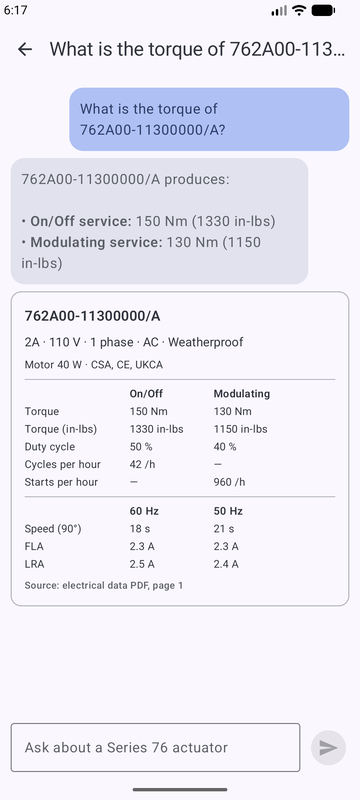
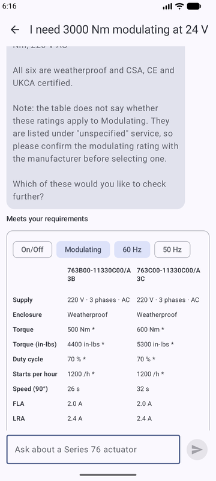
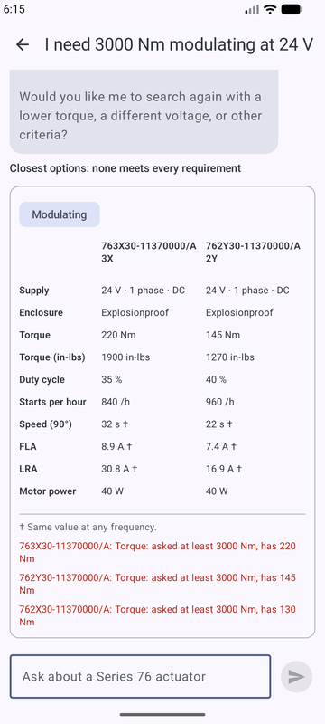
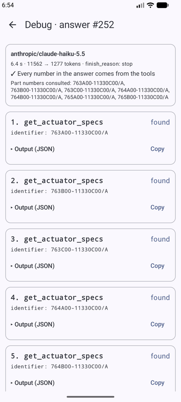

# Series 76 Technical Assistant

A technical assistant for choosing Series 76 electric actuators: a Python backend with an AI agent, and a native Android app.

## Project status

| Part | Status |
|---|---|
| Data ingestion from the PDF | Done |
| Agent tools, tested without an LLM | Done |
| Agent, REST API and conversation history | Done |
| Backend `Dockerfile` | Done |
| Android app: conversations, chat with product cards and comparison table, debug screen, error states | Done |

## Quick start

**You need:** [Docker](https://docs.docker.com/get-docker/) with Docker Compose, and an [OpenRouter](https://openrouter.ai/) API key for the agent to answer.

From the root of the repository, create your configuration:

```bash
cp .env.example .env
```

Open `.env` and set `OPENROUTER_API_KEY` to your key.

Start the database and the backend:

```bash
docker compose up -d --build --wait
```

On startup the backend creates its tables and loads the 68 actuator models, so you do not need to run the ingestion yourself. Open the interactive API documentation at <http://localhost:8000/docs>, or ask a question from the terminal:

```bash
curl -s -X POST http://localhost:8000/api/conversation -H "Content-Type: application/json" -d '{"query": "What is the output torque of 762A00-11300000/A?"}'
```

To continue that conversation, send the `session_id` from the response along with the next question:

```bash
curl -s -X POST http://localhost:8000/api/conversation -H "Content-Type: application/json" -d '{"session_id": "PASTE-IT-HERE", "query": "And how much power does it draw?"}'
```

Without a key everything else works, and asking a question returns a 503 that says the key is missing.

## Running the backend without Docker

For development. You also need [uv](https://docs.astral.sh/uv/getting-started/installation/), which installs the right Python version by itself.

If the Docker backend is running, stop it so port 8000 is free:

```bash
docker compose stop backend
```

Start the database, from the root of the repository:

```bash
docker compose up -d --wait db
```

Move to the backend folder. **All the commands from here on run from `backend/`:**

```bash
cd backend
```

Load the actuator data:

```bash
uv run python ingest.py
```

You should see:

```
Loaded: actuators=68, service_ratings=111, electrical_ratings=118
```

Start the API, which reloads when the code changes:

```bash
uv run uvicorn app.api:app --reload
```

Run the tests. They use a scripted language model, so they spend nothing:

```bash
uv run pytest
```

Try the tools the agent uses, without any language model:

```bash
uv run python try_tools.py recommend min_torque=500 torque_unit=nm service=on_off voltage_v=110 enclosure=weatherproof
```

The database port on your machine is `5433`, so it does not clash with a local PostgreSQL. To use another one, change `POSTGRES_PORT` and `DATABASE_URL` in `.env`.

## Android app

A native app in Kotlin and Jetpack Compose, in `android/`, with three screens: the saved conversations, the chat, and a hidden debug screen.

<p>




</p>

### Run it

You need the backend running, and either Android Studio 2026.2 or later (built with 2026.2.2, which ships the Android Gradle Plugin 9.5.1 this project uses; an older one may refuse to open it) or, from a terminal, the Android SDK and JDK 17+. With the terminal the Android Studio version does not matter: Gradle downloads the SDK platform and build tools it is missing, as long as the SDK licenses are accepted.

1. Start the backend from the repository root: `docker compose up -d --build --wait`.
2. Start an emulator from Android Studio's Device Manager. Any image from Android 8 (API 26) up works: the app was run on Android 8.0 (API 26) and Android 17 (API 37).
3. Open the `android/` folder in Android Studio and press Run. Or, from `android/` in a terminal, tell Gradle where the Android SDK is (Android Studio does this by itself; `~/Android/Sdk` is its default location on Linux) and install:

```bash
export ANDROID_HOME=~/Android/Sdk
```

```bash
./gradlew installDebug
```

4. On Android 17 the app first asks for **local network access**: tap **Allow**. Android 17 blocks apps from private addresses such as `10.0.2.2` without it, and the connection hangs instead of failing. If you denied it, the app explains why it needs it and links to Settings.

### Point it to the backend

| Device | How |
|---|---|
| Emulator | Nothing to do: the default URL, `http://10.0.2.2:8000`, is how the emulator reaches your computer |
| Phone by USB | `adb reverse tcp:8000 tcp:8000`, then `./gradlew installDebug -PbackendUrl=http://localhost:8000`. No permission needed |
| Phone on the same Wi-Fi | `./gradlew installDebug -PbackendUrl=http://192.168.1.50:8000`, with your computer's address |

The URL is fixed at build time in `BuildConfig`. Debug builds allow plain HTTP to any host, because the local backend has no HTTPS; release builds only to `10.0.2.2` and `localhost`.

### Open the debug screen

The debug screen is for developers, so it is hidden behind debug mode:

1. On the conversations screen, **hold "New conversation" for 3 seconds**. A short tap still opens a new chat.
2. Confirm **Enter debug mode?**. A red "Debug mode" label appears in the top bar, and the setting is kept on the phone.
3. In any chat, **long-press the text of an answer** (the grey bubble, not its product card). The debug screen shows the model, latency, tokens, whether every number in the answer came from the tools, and each tool call with its arguments, status and full output, which can be copied.

Hold the button again and choose **Leave** to turn it off. Without debug mode, a long press on an answer does nothing.

### What the chat shows

The answer text explains; the numbers are in cards and tables built from `products`, so they come from the database, not from the model's text.

| What the answer is about | How it looks |
|---|---|
| One model | A card with every value, by service and by frequency, and the PDF page it comes from |
| Several models that qualify, or the closest ones | A comparison table with a service and frequency selector. It opens on what the user asked for (`focus`); alternatives list why each one falls short |
| A partial part number or a typo | A list of models to tap; tapping one asks about it |
| A model listed as N/A | A card that says the tables give no values, and models with data to look at |

3-phase ratings that the PDF does not assign to a service are marked `*`, and 24 V ratings that do not depend on the frequency `†`. A missing value is `—`, never `0`. A question that fails stays on screen with **Retry**; retrying does not duplicate it, because the backend saves a turn whole or not at all.

Questions that show each view: `What is the torque of 762A00-11300000/A?`, then `And how much power does it draw?`; `What about the 1A?`; `I need at least 500 Nm, On/Off, 110 V`; `I need 3000 Nm modulating at 24 V`; `Which 3 phase actuators give at least 400 Nm modulating?`; `761A00-11330C00/A`.

### Loading and errors

| Situation | What the app does |
|---|---|
| Loading | A spinner, or "Looking up the tables…" while an answer is on its way |
| Backend down or unreachable | "Can't reach the server" with **Retry**. A list already on screen stays, with the error above it |
| `503` (model or database unavailable) | "The assistant is temporarily unavailable" with **Retry** |
| `404` (conversation deleted) | "This conversation no longer exists", without Retry |
| No conversations yet | A short hint, and example questions in a new chat |

### How it is built

| Decision | Why | Trade-off |
|---|---|---|
| MVVM: each screen draws a state that its ViewModel owns | Loading, empty and error states are tested without an emulator | More classes than putting logic in the screens |
| Retrofit, kotlinx.serialization and manual dependency injection (`AppContainer`) | Standard and easy to follow; no annotation processing that could fail on another machine | Wiring by hand would not scale to many screens |
| History lives only in the backend | One source of truth; offline use is not required | No offline mode |
| The repository turns network and HTTP failures into app errors | Screens show "can't reach the server" or "temporarily unavailable", not exceptions | One more layer |
| The debug screen reloads the answer from the backend | It shows what was saved, the same for a resumed conversation, with real loading and error states | One more request |
| Debug mode needs a 3-second hold and a confirmation | End users do not find it by accident | Developers must read how to open it |
| UI text in English | The agent answers in English and the client is in North America | — |

**Tests:** `./gradlew testDebugUnitTest`, without an emulator or backend: ViewModels, table formatting, the Markdown subset, debug parsing and the HTTP layer against a fake server. One test reads a real backend response, so a renamed field fails a test instead of leaving an empty cell in the app.

## API

| Endpoint | Purpose |
|---|---|
| `POST /api/conversation` | Ask a question. Without `session_id`, a new conversation starts |
| `GET /api/sessions` | Saved conversations, most recent first: id, title, dates and message count |
| `GET /api/sessions/{id}/messages` | A conversation with every message, to resume it |
| `GET /health` | `200` when the API can answer; `503` while the database is down or the catalog is loading. Also says whether the key is configured |

The response of `POST /api/conversation`:

| Field | Contents |
|---|---|
| `session_id`, `answer` | The fields the assessment fixes |
| `products` | The models the answer is about, always with the same fields (the `Product` schema in `/docs`), filled from the database. Each has a `role`: `specs`, `match`, `alternative`, `option`, `suggestion` or `no_data`. Alternatives add `differences`: why each one does not meet a requirement |
| `focus` | The service and frequency the question was about, taken by code from the tool arguments. The app's comparison table opens there; `null` means On/Off at 60 Hz |
| `needs_clarification` | `true` when the user must add information, such as a voltage or a torque unit. It comes from the tool results; when no tool ran, from whether the answer asks something |
| `debug` | Tools called, their arguments and results, model, tokens, latency and the number check. For the debug screen; end users do not see it |

`products` is built by code from the tool results, never from the model's text, so the app shows numbers that come from the database. Errors: `404` for an unknown conversation, `422` for an invalid request and `503` when the language model or the database is not available. A failed question is not saved.

If the database is down when the backend starts, the backend starts anyway, answers `503` and keeps retrying in the background; it loads the data and recovers by itself when the database is back. It does not crash, so Docker does not restart it in a loop.

## How the agent answers

1. The backend loads the conversation from PostgreSQL and sends the model the text of the latest 20 turns. If older turns exist, the model is told so, and asks instead of guessing when the user refers to one. After each earlier answer it adds the part numbers that answer looked up: `[Part numbers consulted: 762A00-11300000/A]`.
2. The model calls a tool. For a follow-up such as "and how much power does it draw?" it looks the model up again with that exact part number, so the number comes from the database in this turn.
3. Code checks that every number in the answer appears in what the tools returned or in the arguments they received. Any that does not is listed in `debug.unverified_numbers`. The model is told not to do arithmetic: when a value has to be derived, such as the voltage range allowed by the datasheet (198-242 V for 220 V) or a torque in ft-lbs, code computes it and the tool returns it.
4. The question and the answer are saved together, or not at all.

## Language model

The default is `anthropic/claude-haiku-5.5`. It is set with `LLM_MODEL` in `.env`, and any OpenRouter model that supports tool calling works.

### How it was chosen

Three candidates, picked across the price range, answered the same 14 questions. Each question is checked by code from the tool results, not by reading the answer. For example, a follow-up must look up the exact part number from the earlier turn, a torque without a unit must not be searched, and an off-topic question must not be answered. The script also reports cut answers, numbers missing from the tool results, latency and the cost measured on the OpenRouter key.

From `backend/`:

```bash
uv run python eval_agent.py qwen/qwen3.7-flash anthropic/claude-haiku-5.5 openai/gpt-5-mini
```

Results of the final run, with `LLM_MAX_TOKENS=3000`:

| Model | Passed | Numbers not from the tools | Median time per question | Cost per question |
|---|---|---|---|---|
| **`anthropic/claude-haiku-5.5`** | **14/14** | **0** | **3.2 s** | **USD 0.0007** |
| `openai/gpt-5-mini` | 14/14 | 0 | 13.0 s | USD 0.0022 |
| `qwen/qwen3.7-flash` | 13/14 | 0 | 7.6 s | USD 0.0001 |

Claude Haiku 5.5 passed every check in both runs, was the fastest, and costs about USD 0.0007 per question, so the USD 10 budget covers more than 10,000 questions. GPT-5 mini was just as accurate in this run, but four times slower and three times more expensive, which matters in a mobile chat. Qwen was the cheapest, but in a follow-up it searched by the short alias instead of the exact part number, and in the first run it converted units by itself.

The first run, with a limit of 1000 tokens, exposed three problems that were fixed before the final run:

- **Cut answers:** GPT-5 mini and Qwen reason before answering, and with 1000 tokens some answers came out empty. The limit is now 3000, and a cut answer shows in `debug.finish_reason`.
- **An adversarial round:** 58 cases in English and Spanish (81 turns) found three wrong answers, all fixed: "the highest torque model" lost the largest one to the result limit, the agent could not see the notes printed under the tables (voltage +/-10%, frequency +/-5%), and past 6 turns it took the oldest turn it could see for the first. After the fixes the 14 questions above still pass, 14/14 (`backend/eval/results-run4-after-adversarial-fixes.json`). To repeat the round, from `backend/` and with the backend running: `uv run python eval_adversarial.py`. The last results are in `backend/eval/results-adversarial.json`.
- **A second round of hard questions:** 28 new cases found a count that came from a tool and was wrong (a query counted one row per service, so 22 models instead of 11), and search results that included models the user had ruled out. The search now takes a maximum torque, "strictly more than", a size and a certification to exclude, and the options tool returns exact totals (68 models, 4 of them without data). The agent is also told to ask which model "it" means, and not to explain a limit by talking about its tools; `debug.mentions_internals` measures that. The 14 questions stay at 14/14 (`backend/eval/results-run5-new-filters.json`). A search also says when no model has a combination at any rating (weatherproof at 24 V), and code checks every part number in an answer against the tables (`debug.unverified_part_numbers`). The 58 cases ran again on the final code with no wrong values. Still occasional: in 1 of 8 tries it took the first model for "it", and a part number can be mistyped in the text; that is now reported, and the product table is built from the database, so it is not affected.
- **Markdown tables in the answers:** Haiku wrote tables in 3 of 14 answers, which the app showed as raw `|` text next to its own table. The instructions now say not to, and `debug.markdown_table` measures it. A rerun with Haiku alone kept 14/14 with 0 tables (`backend/eval/results-run3-no-tables.json`).
- **An internal marker in the answers:** all three models copied the `[Part numbers consulted]` line into their answers, Haiku in 9 of 14. Code now removes it, and `debug.marker_removed` records when it did.
- **Off-topic answers:** Haiku answered "Paris" before redirecting. The instructions now tell the model not to answer.

Both runs are saved in `backend/eval/`, and together they spent USD 0.11 of the key. These are 14 questions run once per model: enough to choose among three candidates, not a statistical study.

## Data ingestion

### You only need one command

The tables in `series_76_electric_data.pdf` are images, so reading them takes OCR, which weighs several GB. Its reviewed result is versioned in this repository, and the backend loads it on startup. **You do not need to read the PDF again to run the project.** The other commands exist so you can verify where the data comes from.

| What you want | Command, from `backend/` | Needs | Changes |
|---|---|---|---|
| **Load the data into the database** | `uv run python ingest.py` | Running database | Database |
| Rebuild the data from the saved OCR output | `uv run python ingest.py --build` | Nothing | `processed/` |
| Read the PDF again, from scratch | `uv run --group extract python ingest.py --extract` | About 6 GB of packages and up to 5 GB of models | `raw/`, `processed/` |
| Compare with the saved audit readings | `uv run --group extract python ingest.py --audit` | About 6 GB of packages | `audit/` |
| Run the audit with a different model | Set `AUDIT_MODEL` in `.env`, then the same `--audit` command | `GOOGLE_API_KEY` in `.env` | `audit/` |

`--extract` and `--build` do not load the database. Run `uv run python ingest.py` afterwards. Reading the PDF again should leave the data unchanged, which you can confirm with `git status`.

### How the data flows

```
series_76_electric_data.pdf
        │  --extract: Docling reads the table images
        ▼
data/raw/docling_tables.json       what Docling read, untouched
        │  ingestion/spec.py       declared structure of the 7 tables
        │  data/corrections.json   reviewed fixes for misread values
        │  ingestion/build.py      cleans and validates (--build)
        ▼
data/processed/actuators.json      THE RESULT: 68 models
        │  no options: ingestion/load.py
        ▼
PostgreSQL                         what the agent's tools query
```

Separately, as a check that never changes the data, `--audit` has a vision model read the PDF on its own. It compares that reading with `actuators.json` and writes the differences to `data/audit/report.json`.

### Where the data lives

All paths are under `backend/data/`.

| Path | Contents |
|---|---|
| `raw/docling_tables.json` | What Docling read, with its mistakes |
| `corrections.json` | Each misread value, its real value and where in the PDF it was checked |
| `processed/actuators.json` | The reviewed data the database is loaded from |
| `audit/pages/` | What the vision model read, one file per page |
| `audit/report.json` | Differences between that reading and the reviewed data |

### How the numbers were verified

- **Validation:** a rebuild writes nothing if a value is malformed, a row is missing, in-lbs and Nm disagree by more than 5%, or LRA is below FLA. On the first read, this flagged 6 misread speeds, such as `£3` for 33.
- **Review:** every row was compared by eye with the PDF images.
- **Repeatability:** reading the PDF twice on the same machine produced identical files.
- **Independent audit:** `gemini-3.5-flash` read all 68 rows, and 869 cells were compared. It found one difference, the motor power of `764Y30-11300000/A` (reviewed: 180 W, model: 90 W). The PDF image confirms 180 W, so the data did not change.

This lowers the risk of a wrong number, but cannot rule it out entirely.

## Trying the tools

From `backend/`, with the database running and the data loaded. Add `--full` at the end to see the complete result the agent receives.

Look up a model by part number:

```bash
uv run python try_tools.py specs 762A00-11300000/A
```

Look up a short alias that covers several models:

```bash
uv run python try_tools.py specs 1A
```

Try a mistyped part number:

```bash
uv run python try_tools.py specs 761800-11300000/A
```

Try requirements no model meets:

```bash
uv run python try_tools.py recommend enclosure=explosionproof phases=3 min_torque=400 torque_unit=nm
```

List what exists:

```bash
uv run python try_tools.py options
```

## Design and trade-offs

| Decision | Why | Trade-off |
|---|---|---|
| SQL tables, not RAG | "At least 500 Nm" needs an exact comparison, and similarity search can return a close but wrong row | Questions must map to fixed filters |
| Fixed tools; the LLM never writes SQL | A wrong condition would produce a wrong number that looks right | Less flexible |
| Docling for OCR, reviewed data versioned in the repository | Found all 7 tables with no API key. Running the project needs no OCR download | Reading the PDF is a separate, heavy step |
| Table structure declared in code | Merged motor power cells cannot be read reliably, and a mismatch stops the build | Does not work for a PDF with another format |
| Rules report; they never correct | A rule can tell that something is wrong, not which cell is | Each misread value needs a person to check it |
| Torque compared in the unit requested | The PDF rounds each column: 880 in-lbs is listed as 100 Nm, but 100 Nm is about 885 in-lbs. Converting would wrongly reject that model | Only units missing from the PDF are converted |
| 3-phase ratings stored as "unspecified" | The table gives one torque and does not say which service it applies to | Results need a visible warning |
| Follow-ups look the model up again; history carries part numbers, not old data | Every number comes from the database in the turn that shows it, and appears in that turn's debug | One more tool call per follow-up |
| Code checks the numbers in each answer | A prompt is not a guarantee | It reports, never blocks: counts such as "3 models" are not in the tables |
| Tightest fit first; alternatives only if nothing qualifies | Asked-for results first, and much larger actuators are usually unnecessary | The order of alternatives is a reasonable rule, not an engineering truth |

Every decision, the alternatives rejected and the OCR tools compared are in [docs/decisiones-de-diseno.md](docs/decisiones-de-diseno.md), in Spanish. So are the [command guide](docs/guia-de-comandos.md) and the [guide to correcting the data](docs/guia-de-correcciones.md).

## Future improvements

Not built, in rough order of value. The optional login and voice messages were left out to keep the time on the required parts.

**App**

| Improvement | Why |
|---|---|
| Company look: logo, colors and typography | The app uses a neutral Material theme, and the system colors on Android 12 and later |
| Delete and rename conversations | Today they can only be created and opened. It needs a `DELETE` endpoint and a confirmation step |
| Search and filter the conversation list | The list grows with use |
| "Show more" in search results | A search shows 5 models by default, up to 20 |
| Copy a part number, and export a comparison as PDF or CSV | Engineers paste these into purchase orders and reports |
| Answers that appear as they are written | An answer takes a few seconds, and today it arrives all at once |
| Set the backend URL inside the app | Today it is fixed when the app is built |
| Login and voice messages | The two optional parts of the assessment |

**Agent**

| Improvement | Why |
|---|---|
| Write the answer again when a part number is not in the tables | Today code reports it in `debug`, but the user would still read it in the text |
| Decide in code when "it" could mean several models | The instruction works most of the time, not always |
| Report small calculations in the number check | Whole numbers up to 10 are skipped, so "1 second slower" passes |
| Normalize unusual hyphens and slashes in code | Part numbers pasted from a PDF depend on the model cleaning them |

**Backend and data**

| Improvement | Why |
|---|---|
| Database migrations | Tables are created at startup, which does not cover changing an existing schema |
| HTTPS, rate limits and per-user access | Needed before leaving a local network |
| Run the tests and the question sets on every change | Two instruction changes here broke unrelated cases: the 14-question comparison caught one and the 58 adversarial cases the other |
| Dashboards for cost, latency and unverified numbers | `debug` has the data for one answer, not trends |
| A declared format for each new datasheet | The table structure is specific to this PDF, so another product line needs its own |

## Troubleshooting

| What you see | What it means | What to do |
|---|---|---|
| `The language model is not configured` | `OPENROUTER_API_KEY` is missing | Set it in `.env`, then `docker compose up -d` again |
| `The language model could not answer` | OpenRouter failed, for example because the key has no credit left | Check the key on OpenRouter, or try again |
| `Cannot connect to the database` | The database is not running | From the root: `docker compose up -d --wait db` |
| `can't open file ... ingest.py` | You are not in `backend/` | `cd backend` first |
| `No module named 'pydantic_settings'` | You ran plain `python` instead of `uv run` | Start the command with `uv run python` |
| `--extract and --audit need the optional dependencies` | You left out `--group extract` | Use the command it prints |
| `port is already allocated` | Port 5433 or 8000 is in use | Change `POSTGRES_PORT` and `DATABASE_URL`, or `BACKEND_PORT`, in `.env` |
| `N problems, nothing was written` | A value failed validation, so the previous data was kept | See the [guide to correcting the data](docs/guia-de-correcciones.md) |
| The app says `The assistant is temporarily unavailable` | The backend answered 503: usually `OPENROUTER_API_KEY` is not set. `curl -s http://localhost:8000/health` shows `"language_model_configured": false` | Set the key in `.env`, then `docker compose up -d` |
| `SDK location not found` when building the app from a terminal | Gradle does not know where the Android SDK is | `export ANDROID_HOME=~/Android/Sdk`, or open `android/` once in Android Studio |
| The app shows `Can't reach the server` while the backend is up | The app points to another address, or local network access was denied | Check `-PbackendUrl`, and allow Nearby devices for the app in Android Settings |
| `There is no saved reading` | That audit model has not been run | Set `GOOGLE_API_KEY` in `.env` |

## Repository layout

| Path | Contents |
|---|---|
| `backend/ingest.py` | The ingestion script |
| `backend/ingestion/` | Its stages: structure, extract, build, load, audit |
| `backend/data/` | Raw, corrected, processed and audit data |
| `backend/app/` | API (`api.py`), agent (`agent.py`), number check (`numbers.py`), product schema (`products.py`), conversations, queries (`catalog.py`), tools and schema |
| `backend/eval_agent.py`, `backend/eval_adversarial.py`, `backend/eval/` | Compares language models on the same questions, runs the 58 adversarial cases, and the saved results |
| `backend/Dockerfile` | The backend image, without the OCR dependencies |
| `backend/tests/` | Tests |
| `docs/` | The assessment, source PDFs and project guides |
| `android/` | The Android app: `data/` talks to the backend, `ui/` has one folder per screen |
| `.claude/` | AI assistant configuration, together with `CLAUDE.md` |
